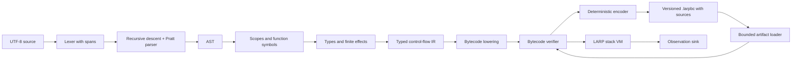

# Compiler and runtime architecture

Status: scalar, closure, option/result, collection, and nominal class programs
compile through typed IR and verified in-memory bytecode to VM execution.
Object/array/closure tracing is implemented. Role dispatch, concrete extensions,
and built-in method extraction are implemented. Scenario regions use isolated
function instances and VM frames. Lazy bindings use checked memoization cells;
output suppression has explicit dynamic scope. Versioned artifacts embed source
maps and pass a bounded loader and mandatory verification before execution.
The pipeline below includes both current contracts and their intended extensions;
see [implementation status](implementation-status.md) for the supported subset.

## Pipeline and contracts

1. **Source:** assign file identities; retain original bytes, line starts, and
   validated half-open spans. Diagnostics refer to file IDs, not copied lines.
2. **Lexer/parser:** handwritten scanner and recursive-descent declarations with
   a Pratt expression parser. This makes unusual token pairs and expression
   precedence explicit. Recover at `;` and balanced braces; preserve error nodes
   so one typo does not produce dozens of false errors. AST nodes retain spans.
3. **Resolution:** collect declaration headers first, then bind bodies to stable
   symbol IDs and lexical scopes. Separate namespaces for types and values.
4. **Semantic analysis:** bidirectional local inference, lexical capture analysis,
   return-path checks, exact payload types, and finite effect bounds through
   direct and indirect calls, nominal class/access checks, and constructor field
   initialization. Role implementation contracts, contextual class-to-role
   conversion, and exact extension resolution are checked before lowering.
   Scenario outlining and transitive call-graph specialization enforce region
   restrictions before lowering.
   Known scalar conditions become single CFG successors, so return checks and
   definite field initialization do not include impossible paths. Both source
   branches are still checked, and regional specialization scans all typed blocks.
5. **Typed IR:** explicit basic blocks, typed local slots, temporaries, calls,
   branch targets, and terminators. Initially use mutable slots rather than SSA.
   Preserve source locations, effect signatures, and lexical region metadata.
   Within a region, snapshot locals implicitly carry `S_r(T)` and the single
   concrete class denotes `View_r(C)`; this qualification survives in bytecode
   function metadata until the verifier has checked every call edge.
   A later SSA optimization pass must not redefine language semantics.
6. **Lowering:** emit typed instructions for numeric widths, locals, branches,
   closures, direct/indirect calls, intrinsics, total result-tag dispatch, and
   observations. Array operations use typed built-in intrinsics with validated
   element/callback signatures. Object operations encode class, field, and method
   identities instead of performing VM source-name lookup. Role conversion and
   dispatch use explicit class/role/method indices. Scenario entry, claims,
   field selection, and inspection use dedicated operations.
7. **Verification:** check instruction indices, stack types at joins, initialized
   locals, branch targets, closure capture layouts, immutable capture slots,
   intrinsic types, call signatures, effect bounds, nominal layout/member access,
   immutable method receivers, constructor operation restrictions, role tables,
   and extension receiver/ownership contracts. Check unreachable code structurally
   as well. Before dataflow, preflight every type in the module,
   including forward-call targets. Bound depth to 128 edges and expanded size
   to 4096 nodes per type, counting shared subtrees repeatedly, so structural
   comparisons and diagnostic formatting remain bounded. Regional frame/call
   checks prevent nesting, reference ingress, and value escape. Host input intrinsics retain `io` through signatures and call graphs;
   runtime capabilities are supplied independently of effect declarations.
8. **VM:** explicit value stack and call frames, checked arithmetic, tagged
   option/result/fixed-array values, and a traced object/array/closure/lazy heap.
   Collection callbacks suspend their caller in explicit continuation state. A LARP runtime
   trap is structured data, not a Rust panic. Active scenario frames are discarded
   when a trap propagates through the VM loop.

The parser may be temporarily exercised without a backend, but the first
executable language slice must go all the way through typed IR and bytecode.
An AST walker may be a test oracle later; it is not the production execution path.

## Workspace boundaries

Current crates:

| Crate | Responsibility |
| --- | --- |
| `larp-source` | Immutable source text, validated spans, locations |
| `larp-diagnostics` | Structured diagnostic data and stable code explanations |
| `larp-types` | Scalar/composite types, typed intrinsics, checked operations, effect bounds |
| `larp-syntax` | Lexer, AST, recovering recursive-descent / Pratt parser |
| `larp-compiler` | Name, type, control-flow, and effect checking |
| `larp-ir` | Typed basic blocks and bytecode lowering |
| `larp-bytecode` | In-memory instructions, dataflow verifier, disassembly |
| `larp-vm` | Iterative frames/callbacks, tagged values, object/array/closure/lazy GC, checked execution, observations |
| `larp-artifact` | Versioned encoding, bounded loading, source maps, mandatory verification |
| `larp-format` | AST annotations, lossless token/comment layout, preservation checks |
| `larp-cli` | `build`, `check`, `run`, `dump`, `fmt`, and `explain` |
| `larp-fuzz-support` | Shared compiler/formatter/loader invariants for stable replay and libFuzzer |
| `larp-scenario-model` | Isolated experiment, not linked into the CLI |

Each crate contains working code. The dependency direction is from
CLI to compiler/runtime, never from semantic libraries to CLI. The VM and
bytecode format must not depend on AST types. Share only deliberately stable
artifact types between the emitter and loader.

Keep the initial workspace dependency-free. Evaluate libraries for CLI parsing,
diagnostic rendering, serialization, property tests, and fuzzing when needed.
A custom source location abstraction is small; a custom terminal layout engine
or cryptographic artifact format is not a good use of engineering time.

## Closures, effects, and result dispatch

Named functions become capture-free closures when used as values. Lambdas are
compiled to generated functions after lexical free-name analysis; capture slots
and generated code identities are explicit in typed IR and bytecode. Polymorphic
prelude references need an expected concrete function type and compile to typed
wrappers. Direct named calls remain direct instructions.

A function type contains invariant parameter/result types and a finite effect
bound. Assignment can widen that bound, while all later indirect calls check the
stored bound against the caller. Container payloads remain invariant. The
verifier checks the same relation; neither wrapping a callback nor storing a
function value removes its effects.

Recovery evaluates the result and handler expression before branching. A typed
`MatchResult` terminator lowers to two verified successors: one receives the
success payload, the other the error payload. Only the latter invokes the
handler. This avoids an unsafe unwrap operation or an artificial abort effect in
pure recovery. IR block parameters become typed stores at branch entry.

## Lazy binding and suppression lowering

A `nonchalant` declaration outlines a parameterless initializer with only
SnapshotValue captures/result and an effect bound contained in `abort`. Capture
analysis copies current values at declaration. Reading an existing lazy binding
during capture forces it immediately; both a new lazy declaration and an ordinary
closure capture the resulting snapshot, not the cell. Thus capture-time failures
and the initializer's actual abort bound remain visible at their correct call
sites. The source binding is immutable even though its memoization cell changes
internally.

Typed IR `Lazy` lowers to `MakeLazy`; source reads lower to `Force` annotated with
the internal lazy type and actual initializer effects. Lazy types are permitted
only in local slots and their stack operations, never API signatures, fields,
containers, or closure captures. The verifier checks zero parameters, snapshot
captures/results, effect bounds, nominal payload validity, and the exact cell
operand/result of forcing. Regional specialization includes `MakeLazy` targets;
local cells stay inside the same checked graph, while outside lazy imports are
rejected rather than silently erasing their provenance.

A heap cell transitions from `Pending` to `Evaluating` to `Ready(value)`. First
forcing enters an ordinary explicit VM frame; later forcing copies the memoized
result. Reentering `Evaluating` reports `LARP-R009`. The forcing frame roots its
cell even after the operand has left the stack. Successful return stores the
result and discards captured inputs. A fatal initializer terminates execution;
there is no retry or recoverable lazy failure.

`sybau` lowers to explicit `SilenceEnter`/`SilenceExit` operations. Source return
and loop break emit the exits for scopes they cross. The verifier tracks local
silence depth and requires equal depth at control-flow joins; it rejects underflow
and excessive nesting. Each VM frame saves the dynamic depth at entry and restores
it on return, so inherited suppression reaches direct, indirect, role, extension,
and callback calls without leaking when the callee returns.

Only the final ordinary `Print` sink write is suppressed. Argument evaluation and
all other computation still happen; `Print` retains its `observe` effect. The
independent inspection sink, diagnostics, fatal errors, and external effects are
unaffected. `sybau` grants no constructor, lazy-initializer, or regional effect
exemption.

## Collections and places

Dynamic arrays carry shared heap identity. Fixed arrays are owned element vectors
with value-copy semantics; copying a reference element retains that element's
identity. Literal construction, indexing, indexed replacement, size, growth,
sorting, and higher-order operations lower to typed intrinsics. The same intrinsic
signature defines operand/result types and required effects for both the compiler
and bytecode verifier. Dynamic reads require `read`, mutation requires `write`,
and checked index/growth operations include `abort`. Fixed-value updates have no
heap mutation effect. Higher-order intrinsics add the callback's static effect
bound to receiver reads; there is no special route around effect checking.

An indexed assignment saves its place's indices and reference receivers and
validates each index before evaluating the right side. An invalid place aborts
before right-side effects; growth on the right cannot make it valid. Compound
assignment also reads the old element first.
Fixed-array ancestors are rebuilt through their saved places after evaluation,
preserving sibling updates made by the right side rather than writing back an
outdated whole-array snapshot. A captured fixed value cannot be reassigned;
references contained within it can still refer to mutable dynamic arrays.

`map`, `filter`, and `forEach` suspend the caller with an iteration record holding
receiver, callback, next index, current filter element, and unfinished output.
Each callback uses an ordinary VM frame. Returning resumes the iteration in the
VM loop, so nested pipelines do not recurse through the Rust stack. A per-array
iteration count rejects `push` before mutation even through aliases or captures.
Indexed replacement is nonstructural and remains allowed. Nested read-only
iterations of one receiver are permitted. Normal completion releases the guard;
a fatal trap terminates execution and releases the owning VM heap.

Filtering and mapping allocate new dynamic arrays; sorting copies the receiver
and uses stable integer/text ordering. Text length counts Unicode scalars.
Dynamic arrays have no equality; fixed-array equality recurses only through
element types that themselves support equality. Extracted built-ins use
generated wrappers over the same typed operations, so indirect invocation retains
callback bounds, iteration guards, and receiver semantics. Monomorphic operations
infer a function type; higher-order built-ins require an expected concrete
callback signature. Fixed-array/text/option/result receivers are copied at
extraction, while dynamic arrays retain their original shared identity.

## Classes and construction

Nominal class identities refer to module layouts containing field types,
visibility, the unique constructor target, and method targets. Recursive class
references remain nominal; type traversal does not expand their field graphs.
The verifier checks referenced class identities and names across every nested
type before instruction dataflow. Field operations carry resolved layout/field
indices and retain `read`/`write` effects. Class equality compares object identity,
including handle generation, rather than field contents.

An instance method is a function with a leading receiver parameter. Its `self`
binding is immutable, while the referenced object's fields remain mutable.
Lexical class ownership authorizes private access and is retained by nested
closures. Extracting a method generates an ordinary closure that captures the
receiver and preserves the method's declared effect bound. Its invocation uses
the same verifier access/signature checks as a direct call.

A constructor has implicit `read,write,abort` bounds. Until successful completion,
`self.field` denotes a typed field local, not a heap object. Control-flow analysis
intersects initialized-field sets at joins, rejects reads before assignment, and
requires every field at each successful exit. Early `return;` and fallthrough
both lower to construction completion; returning an explicit value is rejected.
No partial `self` identity exists to escape, be captured, or receive method calls.

The constructor entry uses `Construct`; the terminal `NewObject` instruction
consumes all ordered field values, allocates the completed identity, and returns
it directly to the caller. Ordinary `Return` is forbidden in a constructor, and
`NewObject` is forbidden outside its registered constructor. Thus bytecode cannot
substitute an existing object for fresh construction or run user code after
publication in the constructor frame. Field operands remain roots at the
allocation safepoint.

Construction may read existing heap state, but ordinary calls/intrinsics with
`write` effects are forbidden, as are observation and I/O. Dedicated nested
`Construct` calls initialize fresh storage and are allowed. Deferred lambda
bodies retain lexical private ownership without inheriting constructor execution
restrictions; invoking a write-bound lambda during construction is rejected.
Reference parameters and captured values therefore cannot provide an alternate
route to external mutation while initialization runs.

## Roles, extensions, and bound built-ins

A role layout contains nominal identity and public method signatures. Each
implementing class stores a complete ordered implementation table whose entries
name its public instance methods. Parameter/result types must match exactly;
implementation effects must fit the role's declared bound. Both declaration
checking and bytecode verification validate these contracts. A role does not
supply storage, inheritance, or a default implementation.

Contextual conversion emits `IntoRole` for a known class/role pair. A runtime
role value contains the original object handle and the role identity. `CallRole`
uses that object's class layout and the verified implementation table to select
the target; its static signature and effect bound come from the role. Extracting
a role method produces a wrapper closure that captures the view and issues the
same dispatch instruction. Role values trace their object handles through locals,
fields, tagged wrappers, collection buffers, and closure captures.

Extensions are ordinary receiver functions with an explicit first `self`
parameter and no class ownership. Module metadata records the exact static
receiver type, name, and target function. Lookup first resolves real class, role,
or built-in members by name; access or signature failures cannot select an
extension instead. Otherwise exactly one concrete receiver/name pair is required.
There is no runtime extension lookup, implicit role conversion for choosing an
extension, private access grant, or user generic extension mechanism.

Extracted built-ins compile to wrapper closures around the existing typed
intrinsics or total result-recovery branch. Receiver evaluation occurs during
extraction and is captured once. `size`, `push`, `sorted`, `isSome`, `isOk`, and
`copium` have inferable concrete signatures. `map`, `filter`, `forEach`, and `cope`
require an expected function type that fixes their callback signature. Wrapper
effects include receiver operations and the callback's declared effects; calling
through a saved method cannot erase them or bypass active iteration guards.

## Runtime representation and memory

The current VM uses tagged Rust `Value` variants: scalar values, tagged
option/result payloads, fixed arrays, nominal conversion errors, and handles for
objects, arrays, closures, and lazy cells. Options, results, and fixed arrays own their payloads; tracing walks
through those wrappers to find contained handles. Text currently uses owned
immutable storage. Avoid NaN boxing until profiling proves a need.

Closures contain a generated function identity and copied captured values, never
Rust references into a VM stack. Ordinary parameters occupy the first frame
slots, followed by immutable capture slots and mutable locals/temporaries.
Nested and returned closures retain their captured values after the creating
frame exits. Capture bindings are snapshots; no source-level capture reassignment
is allowed. Captured objects and dynamic arrays retain shared identity when copied.

Objects, arrays, closures, and lazy cells share a non-moving arena of optional typed entries
with a generation in each reusable handle. Stale generations cannot resolve to a newly
allocated entry; generation overflow is a checked resource failure. The collector
uses iterative marking and sweeping, including transitive handles in captured
options/results/fixed arrays. Object fields, mutable arrays, and closures can
form cycles; unreachable cycles are reclaimed without recursive graph destruction.

Collection occurs before object/closure/array/lazy construction and sorting while
operands are still on the VM value stack, and before publishing completed callback
outputs while their continuation is still rooted. The complete stack,
initialized locals of all active frames, and each suspended iteration's receiver,
callback, current element, and output buffer are roots. A forcing frame also
roots its active lazy cell. Object fields, array elements, closure captures, and
lazy inputs/cached results are traced edges. Stress mode collects at every
such safepoint; the normal threshold adapts to the live heap. CLI `run --gc-stress` and the Rust
`Limits::gc_stress` option select stress mode. `execute_with_stats` exposes allocation,
collection, reclamation, and peak-live counts for tests. A final collection after
successful program exit reclaims the remaining object/array/closure/lazy heap. Trap
paths release the owning Rust heap as execution unwinds.

Role dispatch tables are immutable module metadata; role values trace their
object receiver. Active scenarios additionally root their ordinary object,
baseline/performed buffers, and last claims. Lazy cells retain their inputs until
forcing succeeds, then trace their cached result instead. Preserve stable
language identity across collection and allow
unreachable cycles to be reclaimed. Reclamation timing is unobservable; bounded
pause times are not promised.

## Scenario implementation

A lexical `larp` block is outlined into a generated entry function. Its first
parameter is the root class and its remaining parameters are immutable outer
SnapshotValue imports. Other outer references/functions and outside lazy
bindings cannot be read or stored.
The compiler's regional environment prevents first-class root copies, bound root
methods, outer stores, nested scenarios, and crossing return/break statements.
Ordinary local scopes and loops wholly within the entry remain usable.

The entry and all transitive direct/closure targets form a closed group of
regional function instances. Specialization uses a worklist and memoized target
mapping, including recursive edges and lazy initializer targets. Every instance
retains its source ownership,
signature, effects, and an ordinary origin identity where applicable. Eligibility
checks the complete bodies rather than trusting a `uses()` annotation: no
object/dynamic-array allocation, reference captures/returns, role dispatch, foreign roots,
I/O, or reference-bearing containers. Calls may pass the active view as their
sole class argument. Value-only closures created in the region may be passed to
helpers and invoked indirectly; their parameters/results are snapshots and their
captures are snapshots. An outer arbitrary callback cannot enter the group.

`ScenarioContext { entry, class, origin }` is explicit IR/bytecode metadata.
It qualifies every snapshot local as `S_entry(T)` and each class local as
`View_entry(C)`, including copied temporaries and helper parameters. There is no
unqualified value inside such a frame. The only ordinary-to-regional entrance is
`Scenario`; it creates the view and imports value snapshots. Ordinary calls and
closure construction cannot cross groups or invoke a regional entry. Region
functions cannot return references/functions; the entry returns only unit.
Consequently no instruction can silently erase provenance into an ordinary slot.
The verifier independently checks this closure of the graph, including unreachable
instructions. Specialized method access checks delegate to the verified ordinary
origin, preserving public/private boundaries rather than granting every clone
public access. Origins must preserve signatures, effects, captures, and ownership.

The runtime owns one active scenario state: entry identity, original root handle,
class, label, baseline B, performed P, selected-field bits, and last claims F.
All fields must be SnapshotValues, including private fields. `Value::View` contains
regional identity rather than an ordinary object handle. Ordinary field opcodes
on that receiver access P, including inside specialized helper/method frames;
ordinary object receivers outside the group still access the live object.

`Flex` updates P and F; normal writes leave F intact. `Canon` selects final values,
including selection before a write. `Palantir` carries verified visible field
indices in declaration order and writes to a separate observation sink. The
public `execute_with_observers` API accepts stdout and inspection sinks; legacy
execution APIs discard inspection output, and the CLI directs it to stderr.
Neither sink output is rolled back. Sink failures are fatal runtime diagnostics.

Only return from the outlined entry publishes its selection. The VM first
prepares the complete next vector from B and selected P, then replaces the root's
fields once, with no user code, observation, callbacks, or collection during
publication. Helper returns do not commit. Traps, failed observations, and budget
exhaustion discard the trial and preserve B. Already committed sequential trials
remain committed. Active root/snapshot/claim storage is included in GC roots,
even if ordinary root slots have been overwritten in crafted verified code.

The separate model still tests the transition rule independently; it is not
linked into CLI execution. Selective field commit preserves types, not correlated
application invariants. See [scenario evaluation](scenario-evaluation.md) for
compiled explicit-copy comparisons, failure modes, and measured costs.

## Bytecode artifacts

`larp-artifact` defines a versioned explicit wire format around verified stack
bytecode. Header magic/version/flags and seven ordered bounded sections contain
source text/spans, topological types, roles, classes, extensions, functions, and
entry identity. No Rust enum discriminants or host object layouts are serialized.
See the [version 1 baseline](bytecode-format-v1.md) and
[version 2 input additions](bytecode-format-v2.md) for exact tags and limits.

The decoder validates framing, UTF-8/source boundaries, type shape/expanded work,
counts, and shared logical allocation budgets before independently invoking the
bytecode verifier. Loaded ownership, effects, and region metadata never bypass
instruction checks. Only a `VerifiedModule` can enter the VM. The verifier bounds
complete function headers and module-wide processed analysis cells as well as
per-function stored state. An artifact does not grant host capabilities.

Source maps are embedded rather than reopened by path, preserving diagnostics
after source deletion. The deterministic encoder validates its emitted bytes
through the same loader policy. Build writes a fresh sibling temporary file and
publishes by rename after successful compilation/encoding. Failure preserves
previous output. This is an internal preview format with explicit version
rejection, not a promise of long-term binary compatibility.

## Host capabilities

The runtime receives a borrowed `Host` with independent optional argument/stdin
capabilities. No ambient process lookup occurs in semantic or VM libraries.
Legacy execution entrypoints supply a denied host; the CLI explicitly grants its
argument slice and locked stdin reader. Source bounds require `io`, but only the
host can authorize an operation. Runtime regional checks precede every host input
operation, even though bytecode verification excludes I/O from regional graphs.

Typed input intrinsics have no parameters. Compiler-generated prelude wrappers
now derive their argument slots from signature arity, covering zero-parameter
values as well as the existing one-parameter intrinsics. `args()` initializes a
fresh traced array, collecting while all ordinary operands remain rooted.
`readLine()` returns owned result/option/text values, never a reader handle.
The host preserves its cursor, consumed-byte count, and latched EOF/failure state
across executions. Physical record and total-byte limits precede consumption;
UTF-8 is decoded only after a complete record. See [host input](host-input.md).

## Diagnostics and tools

Semantic phases emit structured English diagnostics with stable codes. Rendering
into terminal text or future JSON happens at the boundary. Keep expected/found
types and related spans in data, not embedded in ANSI strings. Memes never replace
an actionable explanation. The formatter parses source and annotates token spans for generic delimiters
and unary operators. A concrete delimiter tree retains original tokens and
comments, including parentheses and declaration/member order that the grouped
AST does not preserve. A bounded renderer produces deterministic layout. The
result is reparsed and raw token/comment sequences compared before the CLI can
write. Compiler lexing skips comment allocation; tooling opts into a lossless
lexical API. See [formatter policy](formatter.md).

Commands already available: `explain`, artifact `build`, source/artifact `check`
and `run`, IR/bytecode `dump` (`--ir` requires source), and source `fmt` in
write/check/stdout modes. Disassembly includes role method signatures, class implementation tables,
concrete extension metadata, lazy construction/forcing, and silence operations. Next: additional host APIs and tooling integrations. No language
server, incremental query engine, package manager, or optimizer is needed before
basic programs pass conformance.
