# Compiler and runtime architecture

Status: scalar, closure, option/result, collection, and nominal class programs
compile through typed IR and verified in-memory bytecode to VM execution.
Object/array/closure tracing is implemented. Role dispatch, concrete extensions,
and built-in method extraction are implemented. Scenario regions and persisted artifacts remain planned.
The pipeline below includes both current contracts and their intended extensions;
see [implementation status](implementation-status.md) for the supported subset.

## Pipeline and contracts

```mermaid
flowchart LR
    Source[UTF-8 source] --> Lex[Lexer with spans]
    Lex --> Parse[Recursive descent + Pratt parser]
    Parse --> AST[AST]
    AST --> Names[Scopes and function symbols]
    Names --> Types[Types and finite effects]
    Types --> IR[Typed control-flow IR]
    IR --> Lower[Bytecode lowering]
    Lower --> Verify[Bytecode verifier]
    Verify --> VM[LARP stack VM]
    VM --> Host[Observation sink]
```

1. **Source:** assign file identities; retain original bytes, line starts, and
   validated half-open spans. Diagnostics refer to file IDs, not copied lines.
2. **Lexer/parser:** handwritten scanner and recursive-descent declarations with
   a Pratt expression parser. This makes unusual token pairs and expression
   precedence explicit. Recover at `;` and balanced braces; preserve error nodes
   so one typo does not produce dozens of false errors. AST nodes retain spans.
3. **Resolution:** collect declaration headers first, then bind bodies to stable
   symbol IDs and lexical scopes. Separate namespaces for types and values.
4. **Semantic analysis:** bidirectional local inference, lexical capture analysis,
   return-path checks, exact payload types, and finite effect bounds through
   direct and indirect calls, nominal class/access checks, and constructor field
   initialization. Role implementation contracts, contextual class-to-role
   conversion, and exact extension resolution are checked before lowering.
   Scenario eligibility summaries and region restrictions are planned.
5. **Typed IR:** explicit basic blocks, typed local slots, temporaries, calls,
   branch targets, and terminators. Initially use mutable slots rather than SSA.
   Preserve source locations and effect signatures; future region qualifiers
   must survive until all relevant checks run.
   A later SSA optimization pass must not redefine language semantics.
6. **Lowering:** emit typed instructions for numeric widths, locals, branches,
   closures, direct/indirect calls, intrinsics, total result-tag dispatch, and
   observations. Array operations use typed built-in intrinsics with validated
   element/callback signatures. Object operations encode class, field, and method
   identities instead of performing VM source-name lookup. Role conversion and
   dispatch use explicit class/role/method indices. Scenario instructions
   remain future extensions.
7. **Verification:** check instruction indices, stack types at joins, initialized
   locals, branch targets, closure capture layouts, immutable capture slots,
   intrinsic types, call signatures, effect bounds, nominal layout/member access,
   immutable method receivers, constructor operation restrictions, role tables,
   and extension receiver/ownership contracts. Check unreachable code structurally
   as well. Before dataflow, preflight every type in the module,
   including forward-call targets. Bound depth to 128 edges and expanded size
   to 4096 nodes per type, counting shared subtrees repeatedly, so structural
   comparisons and diagnostic formatting remain bounded. Scenario nesting/escape
   and host capability validation must be added alongside those features.
8. **VM:** explicit value stack and call frames, checked arithmetic, tagged
   option/result/fixed-array values, and a traced object/array/closure heap.
   Collection callbacks suspend their caller in explicit continuation state. A LARP runtime
   trap is structured data, not a Rust panic. Future scenario frames must be
   discarded when a trap propagates through the VM loop.

The parser may be temporarily exercised without a backend, but the first
executable language slice must go all the way through typed IR and bytecode.
An AST walker may be a test oracle later; it is not the production execution path.

## Workspace boundaries

Current crates:

| Crate | Responsibility |
| --- | --- |
| `larp-source` | Immutable source text, validated spans, locations |
| `larp-diagnostics` | Structured diagnostic data and stable code explanations |
| `larp-types` | Scalar/composite types, typed intrinsics, checked operations, effect bounds |
| `larp-syntax` | Lexer, AST, recovering recursive-descent / Pratt parser |
| `larp-compiler` | Name, type, control-flow, and effect checking |
| `larp-ir` | Typed basic blocks and bytecode lowering |
| `larp-bytecode` | In-memory instructions, dataflow verifier, disassembly |
| `larp-vm` | Iterative frames/callbacks, tagged values, object/array/closure GC, checked execution, observations |
| `larp-cli` | `check`, `run`, `dump`, and `explain` |
| `larp-scenario-model` | Isolated experiment, not linked into the CLI |

Each crate contains working code. The dependency direction is from
CLI to compiler/runtime, never from semantic libraries to CLI. The VM and
bytecode format must not depend on AST types. Share only deliberately stable
artifact types between the emitter and loader.

Keep the initial workspace dependency-free. Evaluate libraries for CLI parsing,
diagnostic rendering, serialization, property tests, and fuzzing when needed.
A custom source location abstraction is small; a custom terminal layout engine
or cryptographic artifact format is not a good use of engineering time.

## Closures, effects, and result dispatch

Named functions become capture-free closures when used as values. Lambdas are
compiled to generated functions after lexical free-name analysis; capture slots
and generated code identities are explicit in typed IR and bytecode. Polymorphic
prelude references need an expected concrete function type and compile to typed
wrappers. Direct named calls remain direct instructions.

A function type contains invariant parameter/result types and a finite effect
bound. Assignment can widen that bound, while all later indirect calls check the
stored bound against the caller. Container payloads remain invariant. The
verifier checks the same relation; neither wrapping a callback nor storing a
function value removes its effects.

Recovery evaluates the result and handler expression before branching. A typed
`MatchResult` terminator lowers to two verified successors: one receives the
success payload, the other the error payload. Only the latter invokes the
handler. This avoids an unsafe unwrap operation or an artificial abort effect in
pure recovery. IR block parameters become typed stores at branch entry.

## Collections and places

Dynamic arrays carry shared heap identity. Fixed arrays are owned element vectors
with value-copy semantics; copying a reference element retains that element's
identity. Literal construction, indexing, indexed replacement, size, growth,
sorting, and higher-order operations lower to typed intrinsics. The same intrinsic
signature defines operand/result types and required effects for both the compiler
and bytecode verifier. Dynamic reads require `read`, mutation requires `write`,
and checked index/growth operations include `abort`. Fixed-value updates have no
heap mutation effect. Higher-order intrinsics add the callback's static effect
bound to receiver reads; there is no special route around effect checking.

An indexed assignment saves its place's indices and reference receivers and
validates each index before evaluating the right side. An invalid place aborts
before right-side effects; growth on the right cannot make it valid. Compound
assignment also reads the old element first.
Fixed-array ancestors are rebuilt through their saved places after evaluation,
preserving sibling updates made by the right side rather than writing back an
outdated whole-array snapshot. A captured fixed value cannot be reassigned;
references contained within it can still refer to mutable dynamic arrays.

`map`, `filter`, and `forEach` suspend the caller with an iteration record holding
receiver, callback, next index, current filter element, and unfinished output.
Each callback uses an ordinary VM frame. Returning resumes the iteration in the
VM loop, so nested pipelines do not recurse through the Rust stack. A per-array
iteration count rejects `push` before mutation even through aliases or captures.
Indexed replacement is nonstructural and remains allowed. Nested read-only
iterations of one receiver are permitted. Normal completion releases the guard;
a fatal trap terminates execution and releases the owning VM heap.

Filtering and mapping allocate new dynamic arrays; sorting copies the receiver
and uses stable integer/text ordering. Text length counts Unicode scalars.
Dynamic arrays have no equality; fixed-array equality recurses only through
element types that themselves support equality. Extracted built-ins use
generated wrappers over the same typed operations, so indirect invocation retains
callback bounds, iteration guards, and receiver semantics. Monomorphic operations
infer a function type; higher-order built-ins require an expected concrete
callback signature. Fixed-array/text/option/result receivers are copied at
extraction, while dynamic arrays retain their original shared identity.

## Classes and construction

Nominal class identities refer to module layouts containing field types,
visibility, the unique constructor target, and method targets. Recursive class
references remain nominal; type traversal does not expand their field graphs.
The verifier checks referenced class identities and names across every nested
type before instruction dataflow. Field operations carry resolved layout/field
indices and retain `read`/`write` effects. Class equality compares object identity,
including handle generation, rather than field contents.

An instance method is a function with a leading receiver parameter. Its `self`
binding is immutable, while the referenced object's fields remain mutable.
Lexical class ownership authorizes private access and is retained by nested
closures. Extracting a method generates an ordinary closure that captures the
receiver and preserves the method's declared effect bound. Its invocation uses
the same verifier access/signature checks as a direct call.

A constructor has implicit `read,write,abort` bounds. Until successful completion,
`self.field` denotes a typed field local, not a heap object. Control-flow analysis
intersects initialized-field sets at joins, rejects reads before assignment, and
requires every field at each successful exit. Early `return;` and fallthrough
both lower to construction completion; returning an explicit value is rejected.
No partial `self` identity exists to escape, be captured, or receive method calls.

The constructor entry uses `Construct`; the terminal `NewObject` instruction
consumes all ordered field values, allocates the completed identity, and returns
it directly to the caller. Ordinary `Return` is forbidden in a constructor, and
`NewObject` is forbidden outside its registered constructor. Thus bytecode cannot
substitute an existing object for fresh construction or run user code after
publication in the constructor frame. Field operands remain roots at the
allocation safepoint.

Construction may read existing heap state, but ordinary calls/intrinsics with
`write` effects are forbidden, as are observation and I/O. Dedicated nested
`Construct` calls initialize fresh storage and are allowed. Deferred lambda
bodies retain lexical private ownership without inheriting constructor execution
restrictions; invoking a write-bound lambda during construction is rejected.
Reference parameters and captured values therefore cannot provide an alternate
route to external mutation while initialization runs.

## Roles, extensions, and bound built-ins

A role layout contains nominal identity and public method signatures. Each
implementing class stores a complete ordered implementation table whose entries
name its public instance methods. Parameter/result types must match exactly;
implementation effects must fit the role's declared bound. Both declaration
checking and bytecode verification validate these contracts. A role does not
supply storage, inheritance, or a default implementation.

Contextual conversion emits `IntoRole` for a known class/role pair. A runtime
role value contains the original object handle and the role identity. `CallRole`
uses that object's class layout and the verified implementation table to select
the target; its static signature and effect bound come from the role. Extracting
a role method produces a wrapper closure that captures the view and issues the
same dispatch instruction. Role values trace their object handles through locals,
fields, tagged wrappers, collection buffers, and closure captures.

Extensions are ordinary receiver functions with an explicit first `self`
parameter and no class ownership. Module metadata records the exact static
receiver type, name, and target function. Lookup first resolves real class, role,
or built-in members by name; access or signature failures cannot select an
extension instead. Otherwise exactly one concrete receiver/name pair is required.
There is no runtime extension lookup, implicit role conversion for choosing an
extension, private access grant, or user generic extension mechanism.

Extracted built-ins compile to wrapper closures around the existing typed
intrinsics or total result-recovery branch. Receiver evaluation occurs during
extraction and is captured once. `size`, `push`, `sorted`, `isSome`, `isOk`, and
`copium` have inferable concrete signatures. `map`, `filter`, `forEach`, and `cope`
require an expected function type that fixes their callback signature. Wrapper
effects include receiver operations and the callback's declared effects; calling
through a saved method cannot erase them or bypass active iteration guards.

## Runtime representation and memory

The current VM uses tagged Rust `Value` variants: scalar values, tagged
option/result payloads, fixed arrays, nominal conversion errors, and handles for
objects, arrays, and closures. Options, results, and fixed arrays own their payloads; tracing walks
through those wrappers to find contained handles. Text currently uses owned
immutable storage. Avoid NaN boxing until profiling proves a need.

Closures contain a generated function identity and copied captured values, never
Rust references into a VM stack. Ordinary parameters occupy the first frame
slots, followed by immutable capture slots and mutable locals/temporaries.
Nested and returned closures retain their captured values after the creating
frame exits. Capture bindings are snapshots; no source-level capture reassignment
is allowed. Captured objects and dynamic arrays retain shared identity when copied.

Objects, arrays, and closures share a non-moving arena of optional typed entries
with a generation in each reusable handle. Stale generations cannot resolve to a newly
allocated entry; generation overflow is a checked resource failure. The collector
uses iterative marking and sweeping, including transitive handles in captured
options/results/fixed arrays. Object fields, mutable arrays, and closures can
form cycles; unreachable cycles are reclaimed without recursive graph destruction.

Collection occurs before object/closure/array construction and sorting while
operands are still on the VM value stack, and before publishing completed callback
outputs while their continuation is still rooted. The complete stack,
initialized locals of all active frames, and each suspended iteration's receiver,
callback, current element, and output buffer are roots. Object fields, array
elements, and closure captures are traced edges. Stress mode collects at every
such safepoint; the normal threshold adapts to the live heap. CLI `run --gc-stress` and the Rust
`Limits::gc_stress` option select stress mode. `execute_with_stats` exposes allocation,
collection, reclamation, and peak-live counts for tests. A final collection after
successful program exit reclaims the remaining object/array/closure heap. Trap
paths release the owning Rust heap as execution unwinds.

Role dispatch tables are immutable module metadata; role values trace their
object receiver. Lazy cells and scenario snapshots remain planned. Their fields
and temporary allocation buffers must become roots or traced edges before their
allocation instructions can run. Preserve stable language identity across collection and allow
unreachable cycles to be reclaimed. Reclamation timing is unobservable; bounded
pause times are not promised.

## Scenario implementation

A frame owns root identity, B, P, selected-field bits, claim values, and the
scenario label. Copy immutable/scalar field values at entry. Reference-bearing
roots are rejected. No recursive graph copying is hidden behind this operation.

The root name resolves to a `View_r` in the region environment. Value qualifiers
are propagated statically. Method invocation passes a tagged view receiver;
`self` access then uses the performed field vector. Never hand a scenario method
an ordinary root handle and hope it will avoid real mutations. Root-derived
references and other outer aliases cannot be passed, stored, or captured.

Finite effect flags alone cannot prove a call safe: `uses()` does not encode
reference allocation or a closure's reference captures. Compute transitive
scenario-eligibility summaries as well: reference allocation, receiver/argument
footprints, captures, returns, dispatch targets, and escaping stores. For v0.1,
reject unresolved cases. An indirect function type without a verified eligible
target set cannot be called from a scenario. Avoid pretending this is a complete
borrow checker or a general effect calculus.

Compile `flex`, `canon`, and `palantir` to dedicated operations. A final commit
validates the complete prepared state, then replaces the selected real values
without any intervening user code, allocation, or GC. Drop the frame on a VM trap.
Observation sinks are independent of field storage, so output is never rolled
back. Do not implement speculative writes by mutating the live object and trying
to reverse them afterward.

The separate model tests only immutable baseline, performed writes, last claims,
field selection, fallthrough commit, and discard. Rust borrowing in the model is
stronger than the future VM's identity model. It does not prove alias soundness
in LARP, effect inference, or region erasure safety.

## Bytecode artifacts

Begin with an internal instruction enum and in-memory verified modules. Before
`build` writes `.larpbc`, specify magic/version, bounded sections, integer byte
order, constant representations, function signatures, effect/region summaries,
source maps, and entry identity. No Rust enum discriminants or memory layouts
are an external file format. Bound lengths before allocation and reject unknown
versions. Do not deserialize arbitrary host objects.

The verifier is required before loading persisted modules. Compiler output is
not inherently trusted when a file can be edited. Runtime host functions check
capabilities as a second boundary, including active scenario restrictions.
Stack validation alone does not enforce scenario safety. Exact opcodes and
serialization are a later bytecode RFC; freezing them now would be premature.

## Diagnostics and tools

Semantic phases emit structured English diagnostics with stable codes. Rendering
into terminal text or future JSON happens at the boundary. Keep expected/found
types and related spans in data, not embedded in ANSI strings. Memes never replace
an actionable explanation. A formatter must operate on parsed syntax with comment
preservation; it is not a regex substitution pass.

Commands already available: `explain`, `check`, compiler-to-VM `run`, and
IR/bytecode `dump`. Disassembly includes role method signatures, class
implementation tables, and concrete extension metadata. Next: verified artifact `build`/`run`; `fmt`; tooling integrations. No language
server, incremental query engine, package manager, or optimizer is needed before
basic programs pass conformance.
