# Compiler and runtime architecture

Status: proposed implementation direction. Only source/diagnostic infrastructure,
the CLI shell, and the isolated scenario model currently exist.

## Pipeline and contracts

```mermaid
flowchart LR
    Source[UTF-8 source] --> Lex[Lexer with spans]
    Lex --> Parse[Recursive descent + Pratt parser]
    Parse --> AST[AST]
    AST --> Names[Scopes and nominal symbols]
    Names --> Types[Types, effects, scenario regions]
    Types --> IR[Typed control-flow IR]
    IR --> Lower[Bytecode lowering]
    Lower --> Verify[Bytecode verifier]
    Verify --> VM[LARP stack VM]
    VM --> Host[Explicit host capabilities]
```

1. **Source:** assign file identities; retain original bytes, line starts, and
   validated half-open spans. Diagnostics refer to file IDs, not copied lines.
2. **Lexer/parser:** handwritten scanner and recursive-descent declarations with
   a Pratt expression parser. This makes unusual token pairs and expression
   precedence explicit. Recover at `;` and balanced braces; preserve error nodes
   so one typo does not produce dozens of false errors. AST nodes retain spans.
3. **Resolution:** collect declaration headers first, then bind bodies to stable
   symbol IDs and lexical scopes. Separate namespaces for types and values.
4. **Semantic analysis:** bidirectional local inference, nominal types, definite
   initialization, return-path checks, access checks, finite effect bounds,
   call summaries, and scenario region restrictions. Reject before lowering.
5. **Typed IR:** explicit basic blocks, typed local slots, temporaries, calls,
   branch targets, and terminators. Initially use mutable slots rather than SSA.
   Preserve source locations, effects, and regions until all relevant checks run.
   A later SSA optimization pass must not redefine language semantics.
6. **Lowering:** emit typed instructions for numeric widths, locals, branches,
   closures, field access, calls, arrays, observations, and scenarios. Encode
   resolved field/method IDs, never repeat source-name lookup in the VM.
7. **Verification:** check instruction boundaries, indices, stack types at joins,
   initialized locals, branch targets, call signatures, effect bounds, scenario
   nesting, region escape, and host capability use. Reject invalid artifacts.
8. **VM:** explicit value stack and call frames, checked arithmetic, a traced heap,
   and explicit scenario frames. A LARP runtime trap is structured data, not a
   Rust panic. Propagate it through the VM loop while discarding scenario frames.

The parser may be temporarily exercised without a backend, but the first
executable language slice must go all the way through typed IR and bytecode.
An AST walker may be a test oracle later; it is not the production execution path.

## Workspace boundaries

Current crates:

| Crate | Responsibility |
| --- | --- |
| `larp-source` | Immutable source text, validated spans, locations |
| `larp-diagnostics` | Structured diagnostic data and stable code explanations |
| `larp-cli` | Argument handling and the implemented `explain` command |
| `larp-scenario-model` | Isolated experiment, not linked into the CLI |

Add `larp-syntax` when the first scanner/parser slice starts; add semantic, IR,
bytecode, and VM crates as they acquire code. The dependency direction is from
CLI to compiler/runtime, never from semantic libraries to CLI. The VM and
bytecode format must not depend on AST types. Share only deliberately stable
artifact types between the emitter and loader.

Keep the initial workspace dependency-free. Evaluate libraries for CLI parsing,
diagnostic rendering, serialization, property tests, and fuzzing when needed.
A custom source location abstraction is small; a custom terminal layout engine
or cryptographic artifact format is not a good use of engineering time.

## Runtime representation and memory

Use tagged Rust `Value` variants initially: exact-width integers, float, verdict,
unit, and heap handles. Avoid NaN boxing until profiling proves a need. Objects
store class/layout identity and a field vector. Role values contain a receiver
handle and a dispatch-table ID. Closures contain code identity and captured
values, never Rust references into a moving VM stack.

A non-moving tracing collector using an arena of optional heap entries permits
safe Rust and stable integer handles. Include a generation in reusable handles
to detect stale references and make generation overflow a checked host failure.
Trace object fields, container elements, closure captures, lazy cells, and all VM
roots. Unreachable cycles are collectible. Start with stop-the-world mark/sweep;
do not promise bounded pause times.

Collect only at defined safepoints. VM stacks, call frames, temporary operand
buffers, constants, and active scenario snapshots must be roots at those points.
Stress mode collects at every allowed allocation. Object identity remains stable
across collection. A future collector replacement must preserve those contracts.

## Scenario implementation

A frame owns root identity, B, P, selected-field bits, claim values, and the
scenario label. Copy immutable/scalar field values at entry. Reference-bearing
roots are rejected. No recursive graph copying is hidden behind this operation.

The root name resolves to a `View_r` in the region environment. Value qualifiers
are propagated statically. Method invocation passes a tagged view receiver;
`self` access then uses the performed field vector. Never hand a scenario method
an ordinary root handle and hope it will avoid real mutations. Root-derived
references and other outer aliases cannot be passed, stored, or captured.

Finite effect flags alone cannot prove a call safe: `uses()` does not encode
reference allocation or a closure's reference captures. Compute transitive
scenario-eligibility summaries as well: reference allocation, receiver/argument
footprints, captures, returns, dispatch targets, and escaping stores. For v0.1,
reject unresolved cases. An indirect function type without a verified eligible
target set cannot be called from a scenario. Avoid pretending this is a complete
borrow checker or a general effect calculus.

Compile `flex`, `canon`, and `palantir` to dedicated operations. A final commit
validates the complete prepared state, then replaces the selected real values
without any intervening user code, allocation, or GC. Drop the frame on a VM trap.
Observation sinks are independent of field storage, so output is never rolled
back. Do not implement speculative writes by mutating the live object and trying
to reverse them afterward.

The separate model tests only immutable baseline, performed writes, last claims,
field selection, fallthrough commit, and discard. Rust borrowing in the model is
stronger than the future VM's identity model. It does not prove alias soundness
in LARP, effect inference, or region erasure safety.

## Bytecode artifacts

Begin with an internal instruction enum and in-memory verified modules. Before
`build` writes `.larpbc`, specify magic/version, bounded sections, integer byte
order, constant representations, function signatures, effect/region summaries,
source maps, and entry identity. No Rust enum discriminants or memory layouts
are an external file format. Bound lengths before allocation and reject unknown
versions. Do not deserialize arbitrary host objects.

The verifier is required before loading persisted modules. Compiler output is
not inherently trusted when a file can be edited. Runtime host functions check
capabilities as a second boundary, including active scenario restrictions.
Stack validation alone does not enforce scenario safety. Exact opcodes and
serialization are a later bytecode RFC; freezing them now would be premature.

## Diagnostics and tools

Semantic phases emit structured English diagnostics with stable codes. Rendering
into terminal text or future JSON happens at the boundary. Keep expected/found
types and related spans in data, not embedded in ANSI strings. Memes never replace
an actionable explanation. A formatter must operate on parsed syntax with comment
preservation; it is not a regex substitution pass.

Commands land in this order: existing `explain`; real `check`; compiler-to-VM
`run`; verified artifact `build`/`run`; `fmt`; tooling integrations. No language
server, incremental query engine, package manager, or optimizer is needed before
basic programs pass conformance.
